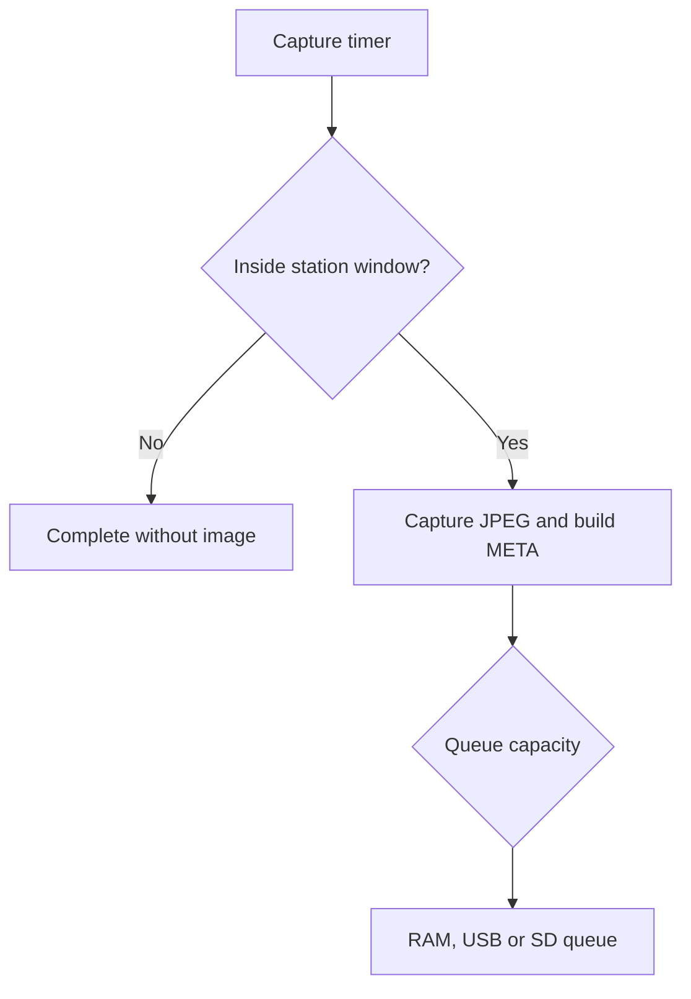
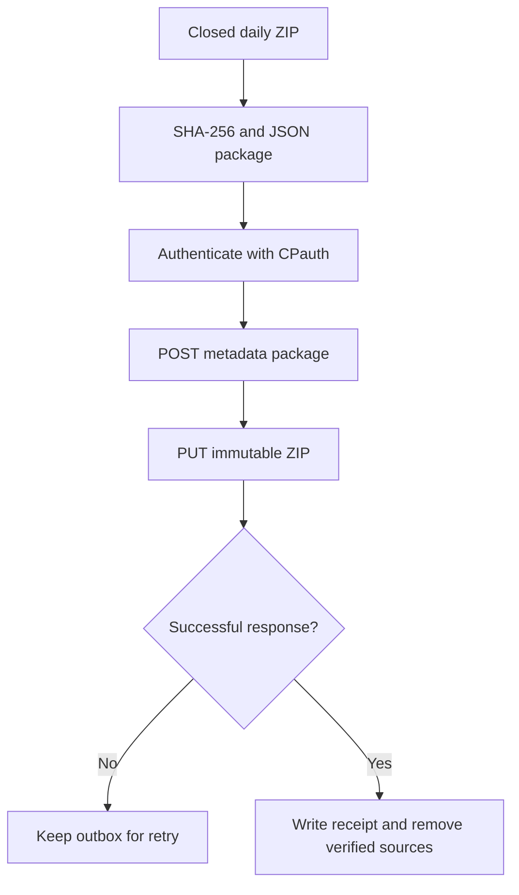

# Software Architecture

OSCARS-PHENOCAM `dev/v0.1.0` is an autonomous Raspberry Pi acquisition system
dedicated to the ICOS Carbon Portal workflow. It captures JPEG images, creates
one metadata sidecar per image, optionally applies edge-based vision screening,
builds one uncompressed Level-0 ZIP for each station-local calendar day and
performs the Carbon Portal standard two-step upload.

Capture and queue processing use separate non-blocking locks. Detection,
packaging and upload execute sequentially under the upload lock.

## Deployed Components

| Path | Purpose |
| --- | --- |
| `/opt/oscars-phenocam` | Local Git repository |
| `/usr/local/lib/phenocam` | Installed runtime and documentation |
| `/etc/phenocam/settings.txt` | Non-secret station and ICOS settings |
| `/etc/phenocam/cp_credentials.txt` | Station-specific Carbon Portal account |
| `/run/phenocam` | Volatile staging, RAM queue and locks |
| `/var/lib/phenocam/queue` | Persistent SD fallback queue |
| `/var/lib/phenocam/icos-outbox` | Immutable daily products awaiting confirmation |
| `/var/lib/phenocam/icos-receipts` | Local records of completed uploads |
| `/var/log/phenocam/phenocam.log` | Runtime log |

Runtime services use the dedicated `phenocam` system user.

## Scheduling

The installer chooses one random `CAPTURE_MINUTE` in the range allowed by
`INTERVAL_MIN` and stores it in `settings.txt`. This value is persistent: it is
reused after reboots and upgrades until an operator explicitly changes it.

With the default 30-minute interval, each new installation randomly selects
one offset from `0` to `29` and stores it permanently. For example, if the
selected value is `13`, capture requests occur at `:13` and `:43`; a different
installation may select another offset. The upload service is requested one
minute after each scheduled capture. These stable, installation-specific
offsets distribute requests over time instead of making every station contact
the service during the same minute.

Systemd catch-up execution is disabled for both timers. After downtime, the
system waits for the next assigned minute instead of creating an off-schedule
image. The capture-plus-upload startup cycle remains available only as an
explicit diagnostic command.

## Capture and Queue Flow



The JPEG and `.meta` sidecar are generated in `/run/phenocam/staging`. Queue
publication copies both files to temporary destination names, verifies the
copies and then renames the JPEG first and the metadata file last. The final
`.meta` filename is therefore the discovery signal for a complete pair. The
staging originals are removed only after successful publication; a complete
pair retained after an interruption is retried before the next acquisition.

Camera Module 3 acquisition intentionally uses a fixed lens position of `0.0`
(focus at infinity) to preserve the selected outdoor imaging configuration
across acquisitions.

Queue selection is RAM first, then a writable USB queue, then the SD fallback.
Queue processing is ordered USB, SD, RAM.

## Optional Edge-Based Vision Screening

Detection runs before packaging. The `.meta` sidecar stores the processing
state, so completed pairs are not analysed again.

| State | Meaning | Eligible for daily product |
| --- | --- | --- |
| `pending` | Not yet processed | No |
| `vision` | Vision Edge result awaits integration validation | No |
| `off` | Screening disabled for this pair | Yes |
| `ready` | Screening result validated | Yes |

The configured modes are `metadata`, `annotated` and `delete`. The default
`metadata` mode records detections without changing the JPEG. A positive
`delete` result removes the pair before it can enter a daily product. Image
blurring is not part of the ICOS workflow. Failures retain the pair for a later
cycle.

## Daily ICOS Product

For each closed station-local calendar day, the manager:

1. discovers all complete `.jpg`/`.meta` pairs belonging to that day;
2. verifies that every pair is in the `off` or `ready` state;
3. rejects duplicate basenames across queues;
4. creates one root-level, uncompressed ZIP containing the JPEG images;
5. records a local SHA-256 manifest of every source JPEG and sidecar;
6. calculates the final ZIP SHA-256 checksum;
7. creates the Carbon Portal JSON metadata package.

The current filename template is:

```text
SITENAME_PHEN_YYYYMMDD_ICOS_FILENAME_SUFFIX.zip
```

The JSON package contains `submitterId`, the ZIP checksum and filename, the
station and instrument URIs, the daily acquisition interval, the
`etcPhenocamDaily` object specification and the ICOS licence. The acquisition
interval represents the complete station-local calendar day converted to UTC.
The number of acquisitions and the active daily window may vary; product
membership is determined by the calendar day.

## Carbon Portal Upload



The same client supports two environments:

| Environment | Authentication | Metadata endpoint | Data endpoint |
| --- | --- | --- | --- |
| `staging` | `cpauthstaging.icos-cp.eu` | `https://metastaging.icos-cp.eu/upload` | `https://datastaging.icos-cp.eu/` |
| `production` | `cpauth.icos-cp.eu` | `https://meta.icos-cp.eu/upload` | `https://data.icos-cp.eu/` |

The client logs in with the station account, POSTs the JSON metadata package,
then uploads the ZIP with chunked HTTP PUT to the SHA-256-addressed data-object
URL. A fresh authentication token is obtained for each attempt.

An unsuccessful network request or server error retains the outbox product for
a later cycle. A local validation error or an HTTP 4xx rejection creates a
`.blocked` marker for operator review. If metadata registration succeeds but
the data PUT fails, the registration marker is retained and the next attempt
repeats only the data PUT.

Source pairs are removed only after the data-service response succeeds and
their current SHA-256 values still match the packaging manifest. If a source
changed, cleanup is refused.

## Configuration Boundaries

Each installation represents one station and uses its own Carbon Portal
account. The account email and password are stored only in the protected
two-line credentials file; they are not exported as general settings and are
not included in image metadata.

`CP_SUBMITTER_ID`, `CP_STATION_URI`, `CP_INSTRUMENT_URI` and the filename suffix
are explicit settings because they are assigned or confirmed outside the
software. The suffix defaults to `nd`, not to an invented logger/file number.
Placeholder values retain queued data and prevent submission.

## Failure Behaviour

| Condition | Result |
| --- | --- |
| Outside acquisition window | No image is created |
| Incomplete pair or unfinished screening | Day remains queued |
| ICOS identity still contains placeholders | Pairs remain queued |
| Credentials absent | Prepared products remain in the outbox |
| No Internet route or HTTP 5xx/408/429 | Product remains available for retry |
| HTTP 4xx or local validation error | Product is marked blocked |
| Successful metadata POST but failed ZIP PUT | Registration is retained and only the PUT is retried |
| Successful ZIP PUT | Receipt is written, verified source pairs are removed |

[Configuration](CONFIGURATION.md) | [Operations](OPERATIONS.md) | [Project README](../../README.md)
